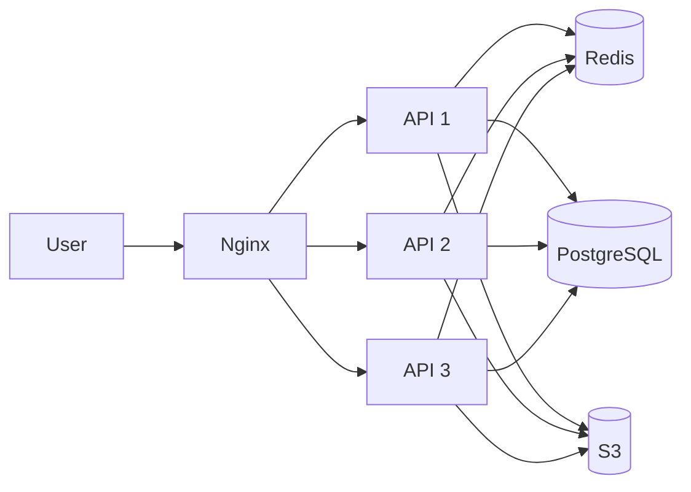
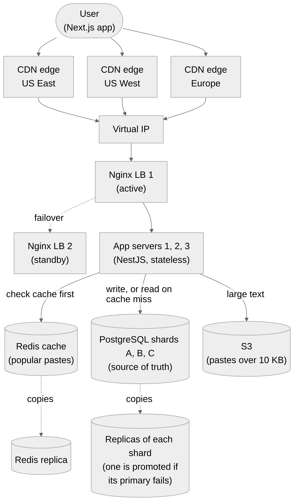
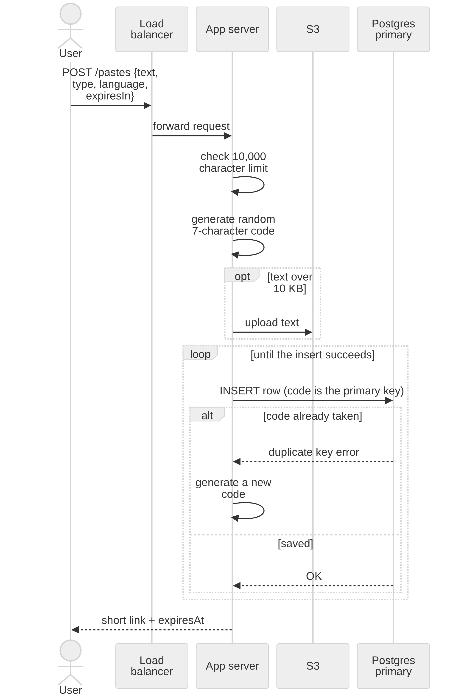
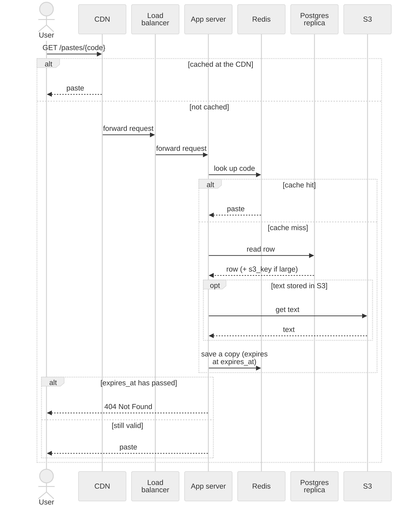
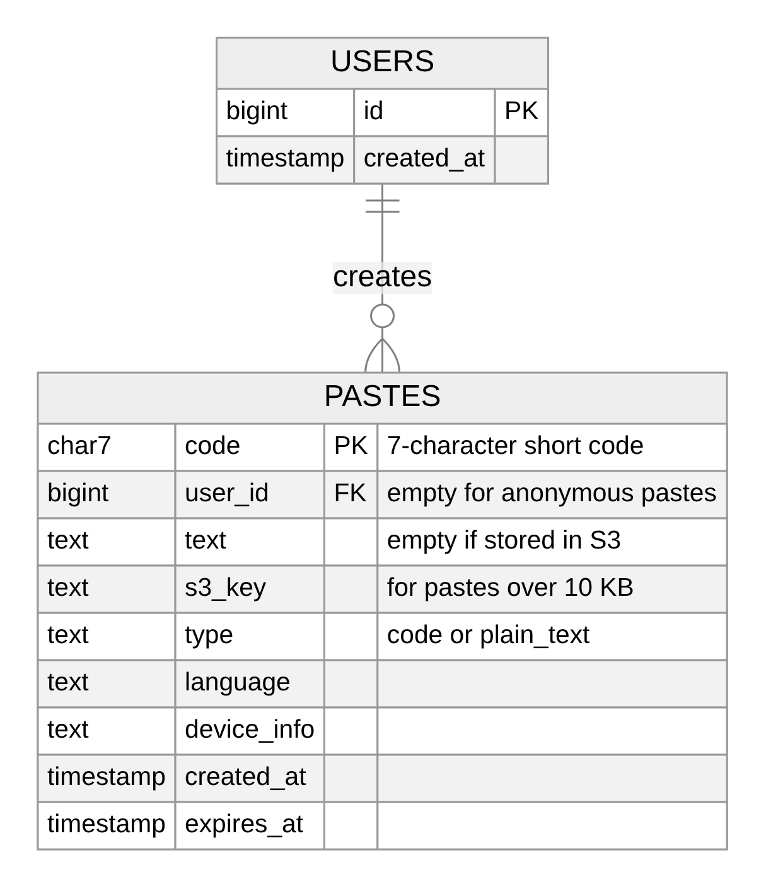

# Pastebin

Paste text or code, get a 7-character link, read it until it expires.
NestJS + TypeORM + PostgreSQL + Redis + S3 (local stand-in) + Nginx, run with Docker Compose.

## Run it

You need Docker and Node 22.

```bash
docker compose up -d --build     # Postgres, Redis, S3, migrations, 3 API containers, Nginx
```

Everything is reached through Nginx on **http://localhost:8080**.

```bash
curl -X POST localhost:8080/pastes -H 'content-type: application/json' \
  -d '{"text":"print(1)","type":"code","language":"python","expiresIn":3600}'
# 201 {"code":"aB3dE9x","url":"http://localhost:8080/pastes/aB3dE9x","expiresAt":"..."}

curl localhost:8080/pastes/aB3dE9x
# 200 {"code":"aB3dE9x","text":"print(1)","type":"code","language":"python","expiresAt":"..."}
```

| | |
|---|---|
| `POST /pastes` | body `{ text, type: "code"\|"plain_text", language?, expiresIn? }`. `expiresIn` is seconds: default 86400, min 60, max 2592000. Returns 201, or 400 (bad input), or 429 (rate limited). |
| `GET /pastes/:code` | 200, or 404 if the code does not exist or has expired. |

Stop everything: `docker compose down` (add `-v` to also delete the data).

### Settings (environment variables)

| Variable | Default | Meaning |
|---|---|---|
| `CACHE_ENABLED` | `true` | `false` switches the Redis cache off (used by the load tests). |
| `RATE_LIMIT_PER_MIN` | `10` | Pastes per minute per IP. `0` turns the limit off. |

Compose passes these through, so: `CACHE_ENABLED=false RATE_LIMIT_PER_MIN=0 docker compose up -d`.

Ports on your machine: Nginx 8080, Postgres 5433, Redis 6380, S3 9000. (5432 and 6379 are left alone in case you already run those.)

## Run the tests

The tests run on your machine and use the Compose services, but their own database (`pastebin_test`), Redis db 1 and bucket (`pastebin-test`), so your data is not touched.

```bash
docker compose up -d postgres redis s3
npm install
npm test
```

They cover: validation (10,000 vs 10,001 characters), expiry in Postgres and in Redis, the 30-second 404 cache, the collision retry (forced duplicate code), the rate limit (11th request is 429, and works again after the minute), S3 for pastes over 10 KB (read back identical), and the cleanup job (removes expired rows and files, keeps the rest).

## Run the load tests

k6 runs from its Docker image, inside the Compose network, so you do not need to install it.

```bash
loadtest/run.sh load true       # main test, cache ON
loadtest/run.sh load false      # same test, cache OFF
loadtest/run.sh failure true    # reads while Postgres is stopped, then started (cache ON)
loadtest/run.sh failure false   # same, cache OFF
```

The script turns the rate limit off, restarts the API containers with the chosen cache setting, and clears Redis first. Use Git Bash (or WSL) on Windows.

To try 10 API containers instead of 3, put `SCALE=1` in front, e.g. `SCALE=1 loadtest/run.sh load true`.

Default rates are the design targets: 350 writes/s and 3,500 reads/s. Scale down with `READ_RATE`, `WRITE_RATE`, `DURATION`, e.g.
`READ_RATE=500 WRITE_RATE=50 DURATION=60s loadtest/run.sh load true`.

Results and what they mean: [loadtest/RESULTS.md](loadtest/RESULTS.md).

## How it works



- **Short code:** 7 random characters from `0-9a-zA-Z`. The row is inserted with the code as primary key. If Postgres says "duplicate", a new code is tried (5 tries, then 500). There is never a "check first, then save".
- **Expiry:** `expires_at` is stored and compared with the clock on every read, including reads served from Redis. An hourly job deletes expired rows and their S3 files. If an S3 delete fails, the rows stay and the next run retries.
- **Cache:** reads check Redis, then Postgres, then save a copy in Redis. The Redis TTL is the time left until `expires_at`. Missing codes are cached for 30 seconds. If Redis is down, reads fall back to Postgres.
- **Big pastes:** over 10 KB (counted in bytes, so multi-byte text counts more) goes to S3. Postgres keeps only `s3_key`. A table constraint makes sure exactly one of `text` and `s3_key` is set.
- **Rate limit:** one Redis counter per IP, expiring after 60 seconds, shared by all API containers. Nginx sets `X-Forwarded-For` to the real client address (overwriting anything the client sent) and Nest trusts exactly that one proxy hop. If Redis is down the limiter lets requests through.
- **Sharding:** only one Postgres runs locally. The choice of shard from a code lives in one function (`shardIndex` in [src/shards.ts](src/shards.ts)). Adding shards means adding data sources there.
- **Migrations:** TypeORM migrations, run once by the `migrate` container before the API containers start.

## Design diagrams

The full design for 30 million users (CDN, active and standby load balancers, sharded Postgres with replicas, S3). This repo builds one local copy of it: Nginx, 3 API containers, Redis, one Postgres and an S3 stand-in. Diagram sources are the `.mmd` files in [docs/](docs/).

**Architecture**



**Creating a paste**



**Opening a link**



**Data model**



## Differences from the spec

- **S3 stand-in is SeaweedFS, not MinIO.** MinIO's public Docker images have been removed (Docker Hub: not found, Quay: 401). SeaweedFS speaks the same S3 API and the app only uses standard S3 calls, so switching back is a change of image and endpoint in `docker-compose.yml`.
- **Nest 11 and TypeORM 0.3** (the CommonJS releases). Newer majors are ESM-only and do not work with Jest on Node 22.
- **API ports are not published.** Only Nginx is reachable from outside. This matters: the API trusts `X-Forwarded-For`, so it must never be reachable directly.
- Next.js client: not built (you chose to skip it for now).

## Layout

```
src/                  the API (controller, service, cache, rate limit, S3, cleanup job, migration)
test/                 API tests (need Postgres, Redis, S3)
loadtest/             k6 scripts, run.sh, analyze.js, RESULTS.md
docker-compose.yml    all services
nginx.conf            load balancer
```
